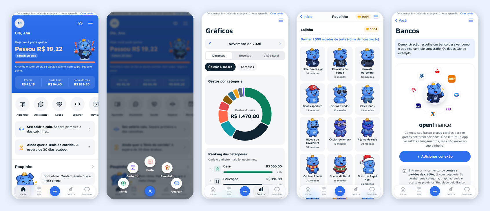

# Poupei

**App de ajuda financeira para quem ganha pouco e nunca teve educação financeira.** Mostra quanto dá para gastar
hoje, ajuda a guardar dinheiro com objetivo e ensina, com um porquinho que reage ao seu dia, métodos que têm base
científica, com exemplos para quem ganha por volta de R$ 3.000.

**[Abrir a demonstração](https://jonethon5.github.io/financas-pessoais/)** (funciona no navegador do celular, sem criar conta)



> Projeto em beta fechado. Os dados da demonstração são de exemplo e ficam só no aparelho de quem abre.

## O problema

A renda média do trabalho no Brasil é de cerca de R$ 3.600 (IBGE, PNAD Contínua, 2º tri. de 2026), e a maioria das
pessoas chega ao fim do mês sem saber para onde o dinheiro foi. Os apps de finanças costumam ser feitos para quem já
tem sobra e já entende de orçamento. O Poupei parte do outro lado: **um número só para olhar no dia**, metas pequenas,
nada de culpa, e o hábito vem antes do valor.

## O que o app faz

- **Quanto posso gastar hoje:** renda do mês menos contas fixas, parcelas e o que a pessoa combinou guardar,
  dividido pelos dias que faltam. Gastou menos hoje? Amanhã sobra mais.
- **Caixinhas:** metas por data, por valor mensal ou livres, com foto, motivo ("o seu porquê") e previsão de quando
  chega. O plano se recalcula sozinho se um mês falhar.
- **Porquinho (mascote):** engorda ou emagrece pela meta que a **própria pessoa** escolheu, não pelo valor em reais.
  Metas do dia viram moedas para a lojinha de roupas. Três modos de falar: suave, moderado e rígido.
- **Aprender:** 16 métodos de livros conhecidos e de estudos publicados (pague-se primeiro, reserva de emergência,
  regra dos 30 dias, bola de neve…), cada um com fonte e exemplo em reais.
- **Saúde financeira:** nota de 0 a 100 em 5 pilares, com o próximo passo e a lição certa para cada um.
- **Assistente:** diagnóstico do mês, plano de corte com valores e "posso comprar isso?". O app faz as contas e a IA
  (Gemini) só escreve, no tom escolhido, sem nunca recomendar investimento.
- **Gráficos:** ranking por categoria, recorrência, débito × crédito, evolução de 6 ou 12 meses, mapa de calor dos dias
  e saldo previsto do mês.
- **Conexão com bancos (Open Finance, só leitura):** os gastos entram sozinhos, sem duplicar o que já foi lançado;
  o app aprende a categoria quando a pessoa corrige uma vez.
- **Guia interativo** no primeiro acesso, **modo escuro**, **valores escondidos** com um toque e **funciona offline** (PWA).


## Destaques técnicos

- **Dinheiro sempre em centavos (inteiros):** nada de `0.1 + 0.2`. As regras de dinheiro são funções puras em
  `src/lib`, com testes para cada uma (incluindo os casos que já deram errado).
- **Segurança no banco, não só na tela:** Row Level Security em todas as tabelas, testado com usuários de verdade
  contra o Supabase local. A loja do porquinho confere o saldo de moedas num gatilho do Postgres.
- **Dois "back-ends" com a mesma interface:** Supabase (conta de verdade) e `localStorage` (demonstração). As telas
  não sabem qual estão usando.
- **Open Finance:** Edge Function que lê contas e cartões pela Pluggy, mapeia descrições ("Pix para Maria"), ignora
  pagamento de fatura e transferências entre as próprias contas e confirma salário e contas fixas já lançados, em vez
  de duplicar.
- **IA com rédea curta:** o app manda para o modelo só totais (sem nome nem descrição dos lançamentos), as contas vêm
  prontas, a base de métodos é gerada a partir das lições do app e há limite de 20 perguntas por dia por pessoa,
  controlado no banco.
- **Gráficos acessíveis:** paleta validada para daltonismo (claro e escuro), legenda com texto e valor, toque para ver
  os números.

## Números

| | |
| --- | --- |
| Testes de regra (Vitest) | 154 |
| Testes contra o banco de dados real (RLS, banco, IA, moedas) | 33 |
| Tabelas com RLS | 21 |
| Edge Functions | 4 (configuração, excluir conta, conexão com banco, assistente) |
| Código | cerca de 13 mil linhas de TypeScript |

## Tecnologias

| Camada | Escolha |
| --- | --- |
| Interface | React 19, TypeScript, Vite, Tailwind CSS 4 |
| Dados no app | TanStack Query (cache e sincronização), React Router |
| Gráficos e ícones | Recharts, Phosphor Icons |
| Back-end | Supabase: Postgres com RLS, Auth, Storage, Realtime e Edge Functions (Deno) |
| Integrações | Pluggy (Open Finance), Google Gemini (IA) |
| Offline e instalação | PWA com service worker (vite-plugin-pwa / Workbox) |
| Qualidade | Vitest, testes de integração no Supabase local (Docker), GitHub Actions |
| Publicação | GitHub Pages (app) e Supabase (banco e funções), por CI |

## Arquitetura em um minuto

```
Telas (src/pages) ──► hooks de dados (src/data) ──► interface Backend
                              │                         ├─ supabaseBackend (conta de verdade)
                              │                         └─ localBackend (demonstração, no aparelho)
                              ▼
                 Regras puras com testes (src/lib)
                 dinheiro, datas, orçamento, caixinhas, saúde, porquinho, gráficos

Supabase: Postgres + RLS (supabase/migrations) · Edge Functions (supabase/functions)
          bank-sync ──► Pluggy (Open Finance)        ask ──► Gemini
```

A explicação completa, com as principais funções e o porquê de cada decisão, está em
**[docs/ARQUITETURA.md](docs/ARQUITETURA.md)**.

## Segurança e LGPD

- Cada pessoa só lê e grava os próprios dados (RLS testado em `tests/db/rls.test.ts`).
- Cadastro no beta exige código de acesso, validado num gatilho do banco.
- Fotos em armazenamento privado. A chave de serviço só existe nas Edge Functions, nunca no app.
- **Excluir conta** apaga tudo na hora. Nenhum segredo nem dado real no repositório.

## Como foi feito

Desenvolvido por mim com **IA como par de programação** (Claude). Eu conduzi o produto, o público, as decisões de
interface e de negócio, testei no celular e revisei o resultado; a IA escreveu boa parte do código sob essa direção.
Foi um exercício de usar IA como ferramenta de trabalho de verdade: especificar bem, revisar, testar e corrigir.

## Rodar no computador

```bash
npm install
npm run dev     # http://localhost:5180/financas-pessoais/ (sem configuração, abre em modo demonstração)
npm test
```

Banco local, conexão com bancos, IA e publicação: **[docs/CONFIGURAR.md](docs/CONFIGURAR.md)**.

## Próximos passos

Abrir o beta para os primeiros testadores com dados reais, notificações no celular, app para Android (Play Store) e,
depois, a versão definitiva do mascote.

---

Feito por [@jonethon5](https://github.com/jonethon5).
