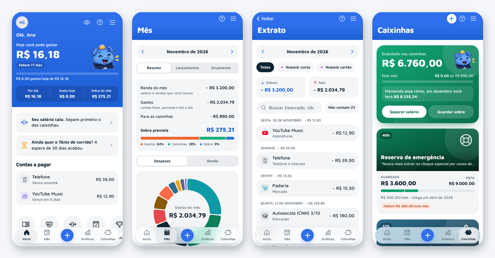
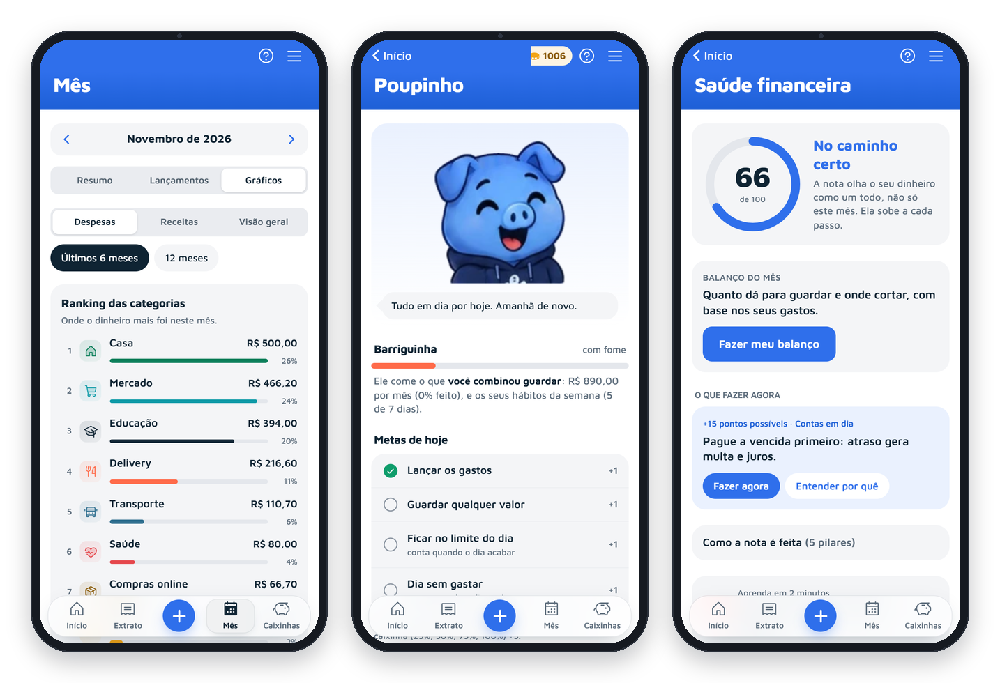
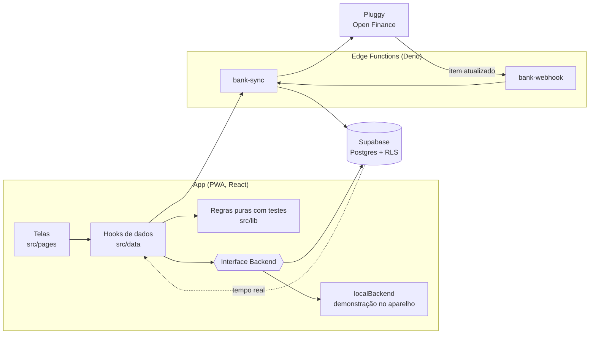

# Poupei

**App de ajuda financeira para quem ganha pouco e nunca teve educação financeira.** Mostra quanto dá para gastar
hoje, ajuda a guardar dinheiro com objetivo e ensina, com um porquinho que reage ao seu dia, métodos que têm base
científica, com exemplos para quem ganha por volta de R$ 3.000.

**[Abrir a demonstração](https://jonethon5.github.io/financas-pessoais/)** (funciona no navegador do celular, sem criar conta)
· **[Vídeo de 26 s (MP4)](docs/img/poupei.mp4)**

[](docs/img/poupei.mp4)

> Projeto em beta fechado. Os dados das imagens e da demonstração são de exemplo e ficam só no aparelho de quem abre.

## Telas

As imagens acompanham o tema do seu GitHub (claro ou escuro), como o próprio app.

<picture>
  <source media="(prefers-color-scheme: dark)" srcset="docs/img/telas-escuro.png">
  <source media="(prefers-color-scheme: light)" srcset="docs/img/telas-claro.png">
  
</picture>

<picture>
  <source media="(prefers-color-scheme: dark)" srcset="docs/img/telas2-escuro.png">
  <source media="(prefers-color-scheme: light)" srcset="docs/img/telas2-claro.png">
  
</picture>

## O problema

A renda média do trabalho no Brasil é de cerca de R$ 3.600 (IBGE, PNAD Contínua, 2º tri. de 2026), e a maioria das
pessoas chega ao fim do mês sem saber para onde o dinheiro foi. Os apps de finanças costumam ser feitos para quem já
tem sobra e já entende de orçamento. O Poupei parte do outro lado: **um número só para olhar no dia**, metas pequenas,
nada de culpa, e o hábito vem antes do valor.

## O que o app faz

- **Quanto posso gastar hoje:** renda do mês menos contas fixas, parcelas e o que a pessoa combinou guardar,
  dividido pelos dias que faltam. Gastou menos hoje? Amanhã sobra mais.
- **A conta do mês, igual em todo o app:** renda − gastos − caixinhas = sobra, com a barra de para onde vai a renda.
- **Contas e cartões juntos:** cada conta e cartão conectado vira um cartãozinho na cor do banco, com saldo, fatura,
  limite livre, dinheiro guardado e o painel de cada um (onde, quando e com que sentimento mais se gasta).
- **Extrato completo:** busca, filtro por conta ou cartão, "Entrou" e "Saiu" como filtro, logo das empresas
  (Uber, iFood…) e **exportação em PDF ou planilha** por período.
- **Caixinhas:** metas por data, por valor mensal ou livres, com foto, motivo ("o seu porquê") e previsão de quando
  chega. O plano se recalcula sozinho se um mês falhar.
- **Porquinho (mascote):** engorda ou emagrece pela meta que a **própria pessoa** escolheu, não pelo valor em reais.
  Metas do dia viram moedas para a lojinha de roupas. Três modos de falar: suave, equilibrado e agressivo.
- **Balanço do mês:** a pessoa escolhe quanto quer guardar (5% a 30%) e o app diz se dá, onde cortar (desejos
  primeiro), aplica os limites e, se não der ainda, mostra o realista e o caminho de subir 1% por mês. Sem IA.
- **Aprender e Saúde financeira:** 16 métodos de livros e estudos (pague-se primeiro, reserva, regra dos 30 dias,
  bola de neve…), cada um com fonte e exemplo em reais, e uma nota de 0 a 100 em 5 pilares com o próximo passo.
- **Menos é mais (auditoria de UX):** o Início responde só 3 perguntas (quanto posso gastar hoje, o que preciso
  pagar, como está o mês) e a barra de baixo tem o que se olha todo dia: Início, Extrato, Mês e Caixinhas. O resto
  fica no menu. Base: lei de Hick, memória de trabalho (Cowan), "Não me faça pensar" (Krug) e *Escassez*
  (Mullainathan e Shafir): com o dinheiro curto, sobra menos atenção para telas cheias.
- **Conexão com bancos (Open Finance, só leitura):** os gastos entram sozinhos, sem duplicar o que já foi lançado; o
  app aprende a categoria quando a pessoa corrige uma vez.
- **"Avalie esta tela"** (como no app do Nubank): no fim de cada tela, 2 perguntas (nota de 5 níveis e o que
  melhorar). O painel do beta mostra a média de cada tela, as piores primeiro, e os comentários.
- **Central de ajuda** com busca, **guia interativo** no primeiro acesso, **modo escuro**, **valores escondidos** com
  um toque e **funciona offline** (PWA).

## Destaques técnicos

- **Dinheiro sempre em centavos (inteiros):** nada de `0.1 + 0.2`. As regras de dinheiro são funções puras em
  `src/lib`, com testes para cada uma (incluindo os casos que já deram errado).
- **Segurança no banco, não só na tela:** Row Level Security em todas as tabelas, testado com usuários de verdade
  contra o Supabase local. A loja do porquinho confere o saldo de moedas num gatilho do Postgres.
- **Dois "back-ends" com a mesma interface:** Supabase (conta de verdade) e `localStorage` (demonstração). As telas
  não sabem qual estão usando.
- **Open Finance fiel ao banco:** Edge Function lê contas, cartões, investimentos e cheque especial pela Pluggy. Nada
  é descartado: fatura, resgate da caixinha, estorno e Pix entre as próprias contas (reconhecido pela categoria, pelo
  mesmo CPF dos dois lados ou pelo nome) aparecem marcados como "não conta". A renda do mês é o salário cadastrado:
  dinheiro que entra na conta só conta se a pessoa disser. Compra pendente relançada com outro id não duplica, e o
  aviso da Pluggy (webhook) faz o app buscar assim que o banco atualiza.
- **IA com rédea curta (desligada no beta, para conter o custo):** o app manda para o modelo só totais, as contas vêm
  prontas e há limite de perguntas por dia controlado no banco. Liga com uma chave quando fizer sentido.
- **Gráficos acessíveis:** paleta validada para daltonismo (claro e escuro), legenda com texto e valor, toque para ver
  os números.

## Números

| | |
| --- | --- |
| Testes de regra (Vitest) | 217 |
| Testes contra o banco de dados real (RLS, banco, IA, moedas, avaliações) | 45 |
| Tabelas com RLS | 22 |
| Edge Functions | 5 (configuração, excluir conta, conexão com banco, aviso da Pluggy, assistente) |
| Código | cerca de 18 mil linhas de TypeScript |

## Tecnologias

| Camada | Escolha |
| --- | --- |
| Interface | React 19, TypeScript, Vite, Tailwind CSS 4 |
| Dados no app | TanStack Query (cache e sincronização), React Router |
| Gráficos e ícones | Recharts, Phosphor Icons |
| Back-end | Supabase: Postgres com RLS, Auth, Storage, Realtime e Edge Functions (Deno) |
| Integrações | Pluggy (Open Finance), Google Gemini (IA) |
| Offline e instalação | PWA com service worker (vite-plugin-pwa / Workbox) |
| Qualidade | Vitest, testes de integração no Supabase local (Docker), GitHub Actions |
| Publicação | GitHub Pages (app) e Supabase (banco e funções), por CI |

## Arquitetura em um minuto



A explicação completa, com as principais funções e o porquê de cada decisão, está em
**[docs/ARQUITETURA.md](docs/ARQUITETURA.md)**.

## Segurança e LGPD

- Cada pessoa só lê e grava os próprios dados (RLS testado em `tests/db/rls.test.ts`).
- Cadastro no beta exige código de acesso, validado num gatilho do banco.
- Fotos em armazenamento privado. A chave de serviço só existe nas Edge Functions, nunca no app.
- **Excluir conta** apaga tudo na hora. Nenhum segredo nem dado real no repositório.

## Vídeo

O vídeo do topo é código: HTML e animações (GSAP) renderizados quadro a quadro em MP4 pela
[HyperFrames](https://github.com/heygen-com/hyperframes). As telas são capturas reais do app. O projeto está em
[docs/video](docs/video).

## Como foi feito

Desenvolvido por mim com **IA como par de programação** (Claude). Eu conduzi o produto, o público, as decisões de
interface e de negócio, testei no celular e revisei o resultado; a IA escreveu boa parte do código sob essa direção.
Foi um exercício de usar IA como ferramenta de trabalho de verdade: especificar bem, revisar, testar e corrigir.

## Rodar no computador

```bash
npm install
npm run dev     # http://localhost:5180/financas-pessoais/ (sem configuração, abre em modo demonstração)
npm test
```

Banco local, conexão com bancos, IA e publicação: **[docs/CONFIGURAR.md](docs/CONFIGURAR.md)**.

## Próximos passos

Ambiente de testes separado, revisão de segurança e beta com 20 testadores; depois, notificações no celular, app
para Android (Play Store), fila de atualização dos bancos para escala e a versão definitiva do mascote.

---

Feito por [@jonethon5](https://github.com/jonethon5).
